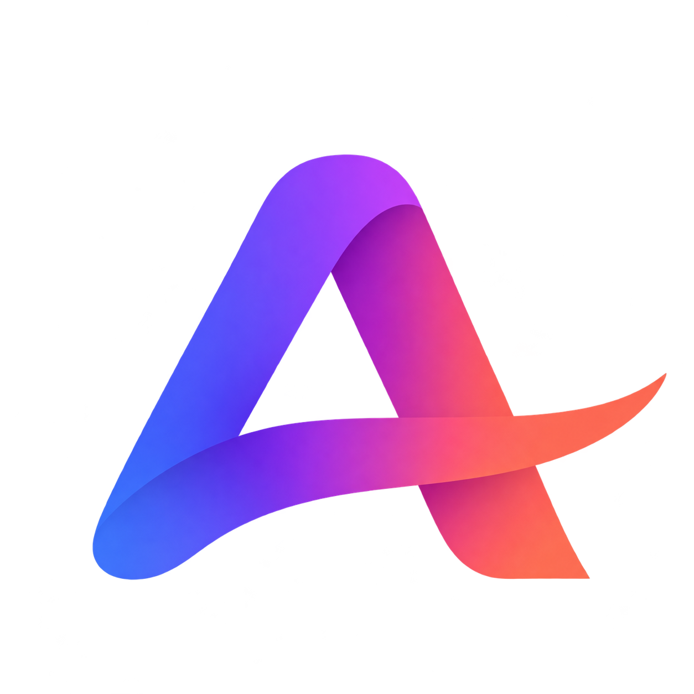

<p align="center">
  
</p>

# ArtBlend

[English](#english) · [Türkçe](#türkçe)

## English

ArtBlend is an experimental, local-first studio for digital drawing, painting, and 2D animation on macOS, iPadOS, and Android tablets. It combines a stylus-oriented canvas, a native brush engine, and a timeline for turning drawings into short films.

**ArtBlend was developed entirely with AI, under human direction.** It is an independent experiment built for learning and creative exploration, with no commercial purpose. The use of AI to develop ArtBlend is separate from the optional AI features inside the app. You can draw, save projects, and animate without connecting to a model.

### What you can do

| Area | Features |
| --- | --- |
| Drawing and painting | Draw with pressure-sensitive input, tune stroke smoothing, and work with freehand, MyPaint, and textured stamp brushes. Pan, zoom, or rotate the canvas and use grids or rotational and mirror symmetry. |
| Layers and selections | Organize artwork with layers, blend modes, and masks. Make rectangular, elliptical, or freehand selections, feather their edges, and move, scale, or rotate selected content. |
| Color and assets | Pick colors from the canvas, import palettes and supported brush presets, and add PNG, JPEG, or WebP images as layers. |
| Projects and export | Manage drawings in a local gallery with autosave. Save editable drawings as `.artdoc` files and export flattened images, including PNG. |
| Animation | Create frame-by-frame drawings in a flipbook with onion skinning, or use a multi-track timeline to arrange drawings, text, and media. Animate properties with keyframes and export movies or image sequences. Movie projects use `.artmovie`. |
| Preferences | Choose English or Turkish, use the system language, and switch between light, dark, and system appearance. |

### Optional AI and agent workflows

- **LocalHub integration.** Pair ArtBlend with LocalHub running on a Mac. Depending on configured models, workflows, and permissions, ArtBlend can use a chat assistant, generate images, and apply generative fill to a selected region. For generative fill, ArtBlend sends the selection and a nearby context crop to the paired hub and places the result on a new layer. Available models depend on the hub configuration.
- **Built-in MCP server.** ArtBlend can expose drawing and movie tools to an external Model Context Protocol client. The server is off by default and requires a bearer token when enabled. This is a separate feature from the LocalHub connection. You can enable it in the app's MCP settings.

### Run from source

The project pins Flutter **3.50.0** in [`.flutter-version`](.flutter-version). Use Xcode for macOS or iPadOS development, or the Android SDK and a configured Android emulator or tablet for Android.

The Dart client for LocalHub is a local path dependency. Place a LocalHub checkout beside the ArtBlend checkout, with its client at `../localhub/clients/dart` relative to this repository root. The client source is required for dependency resolution even if you only use drawing tools. The LocalHub service itself is needed only for the optional features that connect to it.

```text
workspace/
├── ArtBlend/
└── localhub/
    └── clients/
        └── dart/
```

Run these commands from the ArtBlend checkout. Replace `<device-id>` with a device listed by Flutter.

```sh
./scripts/flutterw pub get
./scripts/flutterw run -d macos
./scripts/flutterw devices
./scripts/flutterw run -d <device-id>
```

The wrapper uses Flutter from your `PATH` or from `~/.local/share/flutter/bin/flutter`. Set `FLUTTER_BIN` to select a specific executable.

```sh
./scripts/flutterw analyze
./scripts/flutterw test
```

### Repository layout

- [`apps/studio/`](apps/studio/) contains the Flutter app, drawing and movie editors, native platform projects, and app tests.
- [`packages/artblend_brush_engine/`](packages/artblend_brush_engine/) contains the Dart bindings and native C brush engine. See the package's [third-party notices](packages/artblend_brush_engine/THIRD_PARTY.md) for bundled components such as libmypaint and json-c.
- [`fixtures/`](fixtures/) contains sample brush and palette inputs.
- [`scripts/`](scripts/) contains the Flutter wrapper and device test script.

### Design references

ArtBlend is an independent project. These products were studied as references for specific creative workflows.

- Fluid pen input, brush controls, and the drawing canvas workflow. [Procreate](https://procreate.com/procreate)
- A natural sketching experience, drawing guides, and symmetry tools. [Sketchbook](https://www.sketchbook.com/)
- Expressive brush behavior and the relationship between raster and vector drawing tools. [Adobe Fresco](https://www.adobe.com/products/fresco.html)
- Flipbook drawing, onion skinning, and timeline-based 2D animation. [Procreate Dreams](https://procreate.com/dreams)
- Prompt-driven edits scoped to a selected area. [Adobe Photoshop Generative Fill](https://www.adobe.com/products/photoshop/generative-fill.html)

## Türkçe

ArtBlend, macOS, iPadOS ve Android tabletlerde dijital çizim, boyama ve 2B animasyon için geliştirilen deneysel, yerel öncelikli bir stüdyo uygulamasıdır. Kalemle kullanıma uygun tuvali, yerel fırça motorunu ve çizimleri kısa filmlere dönüştürmek için bir zaman çizelgesini bir araya getirir.

**ArtBlend, insan yönlendirmesiyle tamamen yapay zekâ kullanılarak geliştirildi.** Öğrenme ve yaratıcı denemeler için yürütülen bağımsız bir projedir ve herhangi bir ticari amaç gütmez. Geliştirme sürecinde yapay zekâ kullanılması, uygulamadaki isteğe bağlı yapay zekâ özelliklerinden ayrıdır. Bir modele bağlanmadan çizim yapabilir, projelerinizi kaydedebilir ve animasyon hazırlayabilirsiniz.

### Neler yapabilirsiniz?

| Alan | Özellikler |
| --- | --- |
| Çizim ve boyama | Kalem basıncına duyarlı çizim yapın, çizgi yumuşatmayı ayarlayın ve serbest çizim, MyPaint ve dokulu damga fırçalarını kullanın. Tuvali kaydırın, yakınlaştırın veya döndürün. Izgara ve ayna ya da radyal simetriyle çalışın. |
| Katmanlar ve seçimler | Çizimlerinizi katmanlar, karışım modları ve maskelerle düzenleyin. Dikdörtgen, elips veya serbest seçimler oluşturun, kenarlarını yumuşatın ve seçili içeriği taşıyın, ölçekleyin veya döndürün. |
| Renkler ve varlıklar | Damlalıkla tuvalden renk alın, paletleri ve desteklenen fırça hazır ayarlarını içe aktarın, PNG, JPEG veya WebP görsellerini katman olarak ekleyin. |
| Projeler ve dışa aktarma | Çizimleri otomatik kayıt destekli yerel galeride yönetin. Düzenlenebilir çizimleri `.artdoc` olarak saklayın ve PNG dâhil düzleştirilmiş görsel biçimlerinde dışa aktarın. |
| Animasyon | Flipbook ve soğan zarı görünümüyle kare kare çizim yapın veya çizimleri, metinleri ve medyayı çok kanallı zaman çizelgesinde birleştirin. Anahtar karelerle animasyon oluşturun ve video veya kare dizisi dışa aktarın. Film projeleri `.artmovie` biçimini kullanır. |
| Tercihler | Türkçe, İngilizce veya sistem dilini seçin. Açık, koyu veya sistem temasını kullanın. |

### İsteğe bağlı yapay zekâ ve ajan iş akışları

- **LocalHub entegrasyonu.** ArtBlend'i bir Mac'te çalışan LocalHub ile eşleştirin. Yapılandırılan modellere, iş akışlarına ve izinlere bağlı olarak sohbet asistanını kullanabilir, görsel üretebilir ve seçili alana üretken dolgu uygulayabilirsiniz. Üretken dolguda ArtBlend, seçimi ve yakın çevresinden bir kesiti eşleştirilen LocalHub'a gönderir, sonucu yeni bir katmana yerleştirir. Kullanılabilir modeller LocalHub yapılandırmasına bağlıdır.
- **Yerleşik MCP sunucusu.** ArtBlend, çizim ve film araçlarını harici bir Model Context Protocol istemcisine açabilir. Sunucu varsayılan olarak kapalıdır ve açıldığında erişim anahtarı gerektirir. LocalHub bağlantısından ayrı çalışan bu özelliği uygulamanın MCP ayarlarından açabilirsiniz.

### Kaynak koddan çalıştırma

Proje, [`.flutter-version`](.flutter-version) dosyasında Flutter **3.50.0** sürümünü kullanır. macOS ve iPadOS geliştirmesi için Xcode, Android için Android SDK ile yapılandırılmış bir emülatör veya tablet gerekir.

LocalHub'ın Dart istemcisi bir yerel yol bağımlılığıdır. LocalHub kaynak kodunu ArtBlend ile aynı üst dizine yerleştirin. Bu deponun kökünden istemciye giden yol `../localhub/clients/dart` olmalıdır. Yalnızca çizim araçlarını kullanacak olsanız bile bağımlılıkların kurulması için istemci kaynak kodu gerekir. LocalHub servisinin çalışması ise yalnızca ona bağlanan isteğe bağlı özellikler için gereklidir.

```text
çalışma-alanı/
├── ArtBlend/
└── localhub/
    └── clients/
        └── dart/
```

Komutları ArtBlend deposunun kökünden çalıştırın. `<device-id>` yerine Flutter'ın listelediği cihaz kimliğini yazın.

```sh
./scripts/flutterw pub get
./scripts/flutterw run -d macos
./scripts/flutterw devices
./scripts/flutterw run -d <device-id>
```

`flutterw`, `PATH` üzerindeki Flutter'ı veya `~/.local/share/flutter/bin/flutter` yolundaki kurulumu kullanır. Başka bir kurulum seçmek için `FLUTTER_BIN` değişkenini ayarlayın.

```sh
./scripts/flutterw analyze
./scripts/flutterw test
```

### Depo yapısı

- [`apps/studio/`](apps/studio/) Flutter uygulamasını, çizim ve film editörlerini, platform projelerini ve uygulama testlerini içerir.
- [`packages/artblend_brush_engine/`](packages/artblend_brush_engine/) Dart bağlantılarını ve C ile yazılmış yerel fırça motorunu içerir. libmypaint ve json-c gibi bileşenlerin bilgileri paketin [üçüncü taraf bildirimlerinde](packages/artblend_brush_engine/THIRD_PARTY.md) yer alır.
- [`fixtures/`](fixtures/) örnek fırça ve palet girdilerini içerir.
- [`scripts/`](scripts/) Flutter çalıştırıcısını ve cihaz test betiğini içerir.

### Tasarım referansları

ArtBlend bağımsız bir projedir. Geliştirme sırasında aşağıdaki uygulamalar, belirli yaratıcı çalışma biçimlerini incelemek için referans alındı.

- Akıcı kalem girdisi, fırça kontrolleri ve tuval üzerinde çalışma biçimi. [Procreate](https://procreate.com/procreate)
- Doğal eskiz deneyimi, çizim kılavuzları ve simetri araçları. [Sketchbook](https://www.sketchbook.com/)
- Fırça davranışları ve raster ile vektör çizim araçlarının bir arada kullanımı. [Adobe Fresco](https://www.adobe.com/products/fresco.html)
- Flipbook çizimi, soğan zarı görünümü ve zaman çizelgesine dayalı 2B animasyon. [Procreate Dreams](https://procreate.com/dreams)
- Metin istemiyle seçili bir alanda görsel düzenleme. [Adobe Photoshop Generative Fill](https://www.adobe.com/products/photoshop/generative-fill.html)
